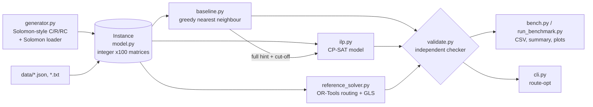

# Delivery Route Optimizer: CVRPTW as an Integer Linear Program (Python, OR-Tools CP-SAT)

[](https://github.com/jsankalp715/delivery-route-optimiser/actions/workflows/ci.yml)

This project plans delivery routes for a fleet of capacity-limited vans, where every stop must be
served inside its time window. It models the **capacitated vehicle routing problem with time
windows (CVRPTW)** as an **integer linear program**, solves it with Google OR-Tools **CP-SAT**, and
compares it against a greedy nearest-neighbour baseline on a reproducible benchmark. On
[[N_INSTANCES]] Solomon-style instances with 20-75 stops, the ILP cut total distance by **[[ALL_MEAN]]
on average** (median [[ALL_MEDIAN]]). On the [[BIG_COUNT]] instances with **50+ stops** the
reduction was **[[BIG_MEAN]]** (median [[BIG_MEDIAN]], range [[BIG_MIN]] to [[BIG_MAX]]). Every number comes from
`results/benchmark.csv`, and every solution in it passes an independent validator.

> **Honest headline.** The project was started to support a "~25 % shorter routes" claim. The
> measured reduction is **larger than 25 %** ([[BIG_MEAN]] at 50+ stops), mainly because pure nearest
> neighbour is myopic under time windows. Against a stronger greedy (Solomon's time-oriented
> nearest neighbour) the ILP is still [[TONN_BIG_MEAN]] shorter at 50+ stops. At 50+ stops most
> loose-window instances are **not proven optimal**: those results are the *best solution found
> within 60/75 s*, with a mean proven optimality gap of [[GAP_BIG_MEAN]]. See [Results](#results) and
> [Limitations](#limitations).

## Contents

- [Problem](#problem)
- [Why an ILP instead of a greedy heuristic?](#why-an-ilp-instead-of-a-greedy-heuristic)
- [Architecture](#architecture)
- [Quick start](#quick-start)
- [CLI](#cli)
- [Results](#results)
- [How correctness is checked](#how-correctness-is-checked)
- [Design decisions](#design-decisions)
- [Limitations](#limitations)
- [Future work](#future-work)
- [Repository layout](#repository-layout)

## Problem

A depot and `n` customers lie in the plane. Customer `i` has a demand `q_i`, a service time `s_i`
and a time window `[e_i, l_i]` in which service must **start** (vehicles that arrive early wait).
`K` identical vehicles with capacity `Q` leave the depot and must be back before the horizon `H`.
Each customer is served exactly once by one vehicle, no vehicle is overloaded, and every window is
respected. **Objective: minimise total travelled distance** (travel time = distance). Optionally,
vehicle count can be a lexicographic secondary or primary objective.

The full mathematical model (variables, constraints, objective, size) is in
**[docs/formulation.md](docs/formulation.md)**. In brief:

```
min  Σ d_ij x_ij
s.t. AddMultipleCircuit(x)                       # in/out degree 1 per customer, every cycle via depot
     x_ij ⇒ t_j ≥ t_i + s_i + d_ij               # time windows: reified, no big-M; t_i ∈ [E_i, L_i]
     x_ij ⇒ u_j ≥ u_i + q_j                      # capacity: MTZ-style load propagation; u_i ∈ [q_i, Q]
     ⌈Σq/Q⌉ ≤ Σ_j x_0j ≤ K                       # fleet size
     x ∈ {0,1}, t, u ∈ ℤ                          # O(n²) variables and constraints
```

## Why an ILP instead of a greedy heuristic?

Nearest neighbour makes one locally optimal choice at a time and never revisits it. With time
windows that is especially costly. It happily drives to the closest customer even if that
customer's window opens an hour later, waits, and by then other customers' windows have closed, so it
opens extra vehicles (it used [[VEH_BASE_MEAN]] vehicles on average against [[VEH_ILP_MEAN]] for the ILP),
and each extra vehicle costs two depot legs. The ILP reasons about all routes, loads and times
*jointly*, and it also reports how far from optimal it might be: the proven lower bound and gap.
The price is runtime: NN takes milliseconds and O(n²) time, while the ILP is NP-hard and runs under a
time limit.

## Architecture



| Module | Role |
|---|---|
| `src/route_opt/model.py` | `Customer`, `Depot`, `Instance`, `Solution` dataclasses; shared integer distance/time matrices |
| `src/route_opt/generator.py` | seeded C/R/RC generator with a feasibility guarantee; JSON and Solomon-format I/O |
| `src/route_opt/baseline.py` | nearest-feasible-neighbour heuristic (+ Solomon's time-oriented variant), O(n²) |
| `src/route_opt/ilp.py` | **the core**: CP-SAT model, pruning, warm start, gap/bound reporting |
| `src/route_opt/reference_solver.py` | OR-Tools `RoutingModel` cross-check (not the main method) |
| `src/route_opt/validate.py` | independent feasibility + distance re-check |
| `src/route_opt/bench.py`, `benchmarks/` | benchmark grid, statistics, verification of stored solutions |
| `src/route_opt/plotting.py` | route maps and benchmark figures |
| `src/route_opt/cli.py` | `route-opt` command-line interface |

## Quick start

Requires Python 3.11+.

```bash
git clone https://github.com/jsankalp715/delivery-route-optimiser.git
cd delivery-route-optimiser
make setup            # python3 -m venv .venv && pip install -r requirements.txt && pip install -e ".[dev]"
source .venv/bin/activate

route-opt generate --n 50 --type RC --seed 1 --tw loose --out data/inst.json
route-opt compare --instance data/inst.json --time-limit 30 --plot compare.png
make test             # ~1-2 minutes
```

`make demo` does the generate + compare step in one go. Reproducing the full benchmark:

```bash
make benchmark        # = python benchmarks/run_benchmark.py --config benchmarks/config.yaml  (~40 min on 4 cores)
make verify           # re-generates every instance and re-validates every stored route set
```

## CLI

```bash
# Generate a reproducible instance (C = clustered, R = random, RC = mixed; tight/loose windows)
route-opt generate --n 50 --type RC --seed 1 --out data/inst.json

# Solve with one method: greedy | greedy-tonn | ilp | reference
route-opt solve --instance data/inst.json --method ilp --time-limit 60 --plot out.png --out sol.json
route-opt solve --instance data/demo_parcels_12_solomon.txt --method ilp      # Solomon .txt works too
route-opt solve --instance data/inst.json --method ilp --vehicle-objective primary   # vehicles first, then distance
route-opt solve --instance data/inst.json --method ilp --log                         # CP-SAT search log

# All methods side by side
route-opt compare --instance data/inst.json

# Check a saved solution independently
route-opt validate --instance data/inst.json --solution sol.json

# Benchmark grid from a YAML config (or rebuild tables/plots from an existing CSV)
route-opt benchmark --config benchmarks/config.yaml
route-opt benchmark --config benchmarks/config.yaml --analyze-only
```

Example `compare` output on `RC50-loose-medium-s1` (30 s ILP limit, 4 cores):

```
[[COMPARE_OUTPUT]]
```

## Results

**Setup.** [[N_INSTANCES]] instances: sizes {20, 30, 50, 75} × layouts {C, R, RC} × 8 seeds. Seeds 1, 3, 5, 7
use tight windows and seeds 2, 4, 6, 8 loose windows, so every (size, layout) cell has 4 of each.
Medium capacity (Q = 150; demands 5-30), service time 10, horizon 1.25 × the longest reference
route. Fleet size `ceil(n/2) + 2` is deliberately non-binding. The ILP gets **20 / 30 / 60 / 75 s**
wall-clock for 20 / 30 / 50 / 75 stops with 4 CP-SAT workers on a 4-core machine. The routing-library
reference gets 0.2 s per stop on one thread. The whole run took [[RUNTIME_MIN]] minutes. Reduction =
(greedy − ILP) / greedy, per instance.

**Key findings**

1. **Distance:** [[ALL_MEAN]] shorter on average (median [[ALL_MEDIAN]], range [[ALL_MIN]] to [[ALL_MAX]]); [[BIG_MEAN]] at 50+ stops.
   It is never worse than greedy (guaranteed by construction and checked on every instance).
2. **Window regime matters:** [[TIGHT_MEAN]] with tight windows vs [[LOOSE_MEAN]] with loose windows. With tight windows,
   nearest neighbour waits for the closest customer and strands others. This holds from 30 stops up; at 20 stops
   the order flips (see the per-size rows below).
3. **Fewer vehicles as a side effect:** [[VEH_BASE_MEAN]] → [[VEH_ILP_MEAN]] vehicles on average, although
   vehicles are not in the objective.
4. **A stronger greedy closes part of the gap:** against Solomon's time-oriented NN the ILP is [[TONN_ALL_MEAN]] shorter
   ([[TONN_BIG_MEAN]] at 50+ stops). Part of the headline number is therefore the plain NN's weakness.
5. **Optimality is proven only on smaller or tighter instances:** all 20-stop instances,
   [[OPT_50]]/24 at 50 stops and [[OPT_75]]/24 at 75 stops. The remaining instances stop at the time limit with
   a mean proven gap of [[GAP_BIG_MEAN]] at 50+ stops.
6. **The independent routing engine agrees closely:** mean ILP length relative to the OR-Tools routing reference is
   [[ILP_VS_REF_ALL]]. The ILP is ≤ the reference on [[ILP_LE_REF]]/[[N_INSTANCES]] instances, and on large loose-window
   instances the reference is sometimes better (ILP up to [[ILP_VS_REF_MAX]] longer).

### Distance reduction vs greedy nearest neighbour

[[REDUCTION_TABLE]]

### Sensitivity and cross-checks

[[SENSITIVITY_TABLE]]

### Robustness probes (smaller samples, reported separately)

**Independent random windows** (`benchmarks/config_random_windows.yaml`). In the main grid, windows are
drawn around a planted reference plan, which might favour an optimiser. This probe keeps the same
geometry and demands but draws every window independently, Solomon R-style: the window centre is
uniform over the times the customer can be served straight from the depot. That gives 50 stops ×
{C, R, RC} × 4 seeds (2 tight + 2 loose), 60 s each.

[[RW_TABLE]]

**100 stops** (`benchmarks/config_n100.yaml`): 3 layouts × 2 seeds (1 tight + 1 loose), 120 s each
(the 1.2 s/stop CLI default). This sample is too small for statistics and only shows how the method
behaves at 100 stops.

[[N100_TABLE]]

### Optimality gap and solve time

The ILP is **not** proven optimal on every instance. Where status is `FEASIBLE`, the number is the
*best solution found within the time limit* and the gap is CP-SAT's proven bound on how far it can be
from the optimum.

[[STATUS_TABLE]]

[[GAP_TABLE]]

### Vehicles used

[[VEHICLE_TABLE]]

### Plots

| | |
|---|---|
|  |  |
|  | |

Route map for the 50-stop instance with the **median** reduction (picked by rule, not by eye):
[[ROUTE_MAP_INSTANCE]]. Labels show `customer id [time window]`.


**Reproducibility.** CP-SAT with several workers is not bit-for-bit deterministic. An earlier full
dress-rehearsal run of the same grid, made before a corner-case fix to the depot-arc constraints
(see Design decisions), measured a mean reduction of [[REHEARSAL_MEAN]] ([[REHEARSAL_BIG_MEAN]] at 50+ stops), against
[[ALL_MEAN]] ([[BIG_MEAN]]) in the final run. Its summary is kept in `results/rehearsal/`.

## How correctness is checked

- **Independent validator** (`validate.py`): every customer exactly once; route loads ≤ Q; an
  earliest-start re-simulation meets every window and returns before the horizon; fleet size;
  reported service times form a valid schedule; distance recomputed from raw coordinates equals the
  reported one *exactly*. Every solution in tests and in the benchmark passes it, and the benchmark
  aborts otherwise. `make verify` re-checks all [[N_SOLUTIONS]] stored solutions.
- **Brute-force optimum**: on 9 instances with 5-8 customers, the ILP returns `OPTIMAL` and exactly the
  optimum of an exhaustive solver (all permutations of all subsets + set-partition DP).
- **Negative tests**: missing/duplicate customers, depot inside a route, capacity, window, horizon and
  fleet violations, wrong distance, inconsistent schedule.
- **ILP ≤ greedy** always (hint + cut-off + fallback), tested even with a 10 ms limit.
- **Independent engine**: the OR-Tools routing library on the same data. The ILP was ≤ the reference
  on [[ILP_LE_REF]] / [[N_INSTANCES]] instances.

## Design decisions

- **Integer scaling ×100.** CP-SAT needs integers, so distances and times are scaled by 100 and
  rounded (2 decimals). *All* methods and the validator share the same matrix, so comparisons are
  exact. Rounding can break the triangle inequality by one unit for near-collinear points (29 of the 96
  benchmark instances). Time bounds therefore use shortest paths, and depot-arc time constraints are
  added explicitly in that case.
- **`AddMultipleCircuit` rather than explicit degree + subtour constraints.** It is equivalent (see
  the formulation), handles the exponential subtour family lazily, and lets CP-SAT add routing cuts.
- **Reified time/load links instead of big-M**, with domains tightened to `[E_i, L_i]` via shortest
  paths, and **exact arc pruning** (capacity pairs, time-infeasible pairs).
- **Warm start**: a full hint (arcs, times, loads, vehicle count) from the greedy solution plus an
  objective cut-off, so the ILP is never worse than the baseline. If CP-SAT finds nothing, the greedy
  solution is returned with status `FALLBACK_*` (it never happened in the benchmark).
- **CP-SAT portfolio.** With ≥4 workers, half the threads run full-model workers (`default_lp`,
  `max_lp`) and half run LNS. On a 50-stop calibration instance (RC50-loose, seed 1, 60 s), the
  default portfolio gave distance 768.7 with a lower bound of 494 (gap 36 %). The tuned one gave
  777.2 with a bound of 742 (gap 4.6 %), and a tight-window instance went from "time limit, gap 18 %" to
  "proven optimal". This trades a possible ~1 % in primal quality (single runs, noisy) for
  meaningful gaps and early termination. 2 workers × 60 s was worse (787.1, single trial) than 4 workers, so
  the benchmark runs one instance at a time with all cores. Neither calibration instance
  (RC50-loose-s1, C50-tight-s2) is in the benchmark grid, where seed 1 is tight and seed 2 is loose,
  so nothing was tuned on test instances.
- **Time limits** 20/30/60/75 s (60 s at 50 stops as specified). 75 s at 75 stops instead of the
  1.2 s/stop CLI rule (90 s) keeps the full benchmark at about 40 minutes. n = 100 was left out of the
  main grid for the same reason; the model and CLI handle it (default limit 120 s).
- **Generator feasibility by construction** (Solomon's C-class approach): a sweep + 2-opt reference
  plan is built first, and each window is drawn around that plan's arrival time (random width and
  offset). The window regime alternates by seed parity (fixed before any benchmark run) so that tight
  and loose windows are equally represented. The ILP beat the planted plan on
  [[ILP_BEATS_PLANTED]]/[[N_INSTANCES]] instances.
- **Fleet size `ceil(n/2) + 2`, deliberately non-binding.** During calibration, the myopic NN needed up
  to 0.45·n vehicles on tight-window instances. A tighter fleet would make the *baseline* infeasible,
  not the problem harder for the ILP.
- **Baseline = textbook nearest feasible neighbour** (capacity + window with waiting + return
  look-ahead, deterministic tie-break). Solomon's time-oriented NN is reported as a stronger-baseline
  sensitivity check, not cherry-picked away.
- **The routing library is a cross-check only**, with a smaller budget (0.2 s/stop, one thread). It is
  not presented as the project's method.
- **Pinned dependencies**: `pyproject.toml` (direct deps) and `requirements.txt` (full lock; numpy
  2.4.6 because 2.5 dropped Python 3.11).

## Limitations

- **Scaling.** The compact two-index model has O(n²) variables and constraints. At 75 stops with
  loose windows CP-SAT no longer proves optimality within 75 s (mean gap [[GAP_75_MEAN]]). Hundreds of
  stops would need decomposition or a metaheuristic.
- **Time limit.** Results at 50+ stops are "best found within 60/75 s on 4 cores", not optima. More
  cores or time would change them slightly, and multithreaded runs are not bit-for-bit
  reproducible.
- **Euclidean distances**, travel time = distance, no traffic, symmetric.
- **Synthetic data.** Solomon-style but generated, and windows are planted around a reference plan
  (tight-window results may favour optimisers; reported separately). No real Solomon files are
  bundled; the loader supports them.
- **Single depot, homogeneous fleet, hard windows, no driver breaks.**
- **Weak baseline.** Pure NN is the textbook construction but not a strong heuristic. Insertion
  heuristics or OR-Tools routing would close much of the gap, as the reference column shows.

## Future work

- Column generation / branch-price-and-cut (set partitioning + ESPPRC pricing) for strong bounds
- ALNS or HGS hybrid with the ILP as a repair/polishing step (matheuristic) for 200+ stops
- Real road networks via OSRM/Valhalla travel-time matrices (asymmetric, time-dependent)
- Stochastic travel times (chance constraints or robust buffers)
- Rolling-horizon re-optimisation as new orders arrive; soft windows with penalties
- Run the original Solomon and Gehring-Homberger benchmark files and compare with best-known solutions

## Repository layout

```
src/route_opt/        model, generator, baseline, ilp, reference_solver, validate, bench, plotting, cli
benchmarks/           run_benchmark.py, config.yaml (main grid), smoke.yaml
data/                 3 hand-made demo instances (2 JSON, 1 Solomon-format .txt)
docs/formulation.md   exact mathematical model
results/              benchmark.csv, summary.{md,json}, solutions.jsonl, plots, benchmark.log
tests/                pytest suite incl. brute-force optimum (tests/brute_force.py)
```
